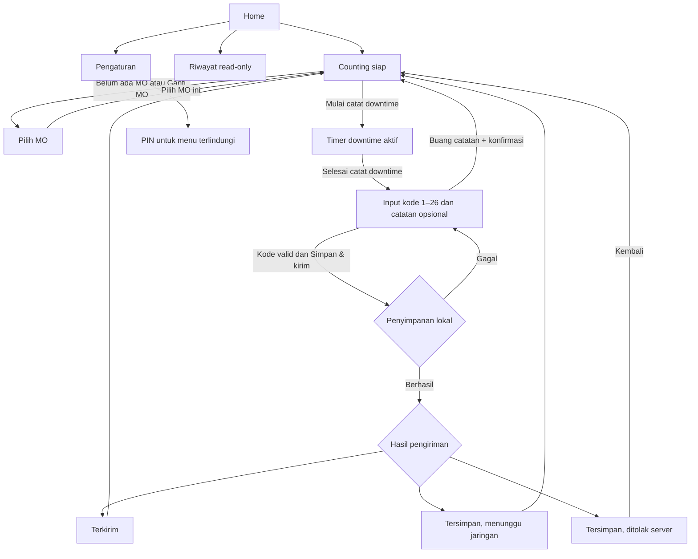

# Audit & Design Spec: Dandori — Precision HMI
Platform: layar perangkat Waveshare ESP32-S3-Touch-LCD-7C, 800×480, touch GT911, LVGL 9.4
Cakupan: seluruh alur UI; usulan, belum disetujui untuk implementasi
Kritik pra-serah dokumen: P4 H4 E3 S5 R5 V4. Bukan skor hasil render; validasi perangkat belum dilakukan.

## Dasar audit
- Hallmark: SKILL.md, references/anti-patterns.md, structure.md, slop-test.md. Prinsip: struktur mengikuti pekerjaan operator, token terkunci, tanpa dekorasi generik.
- frontend-design: SKILL.md. Prinsip: hierarki, state, keterbacaan, aksesibilitas. Default corporate tidak dipakai.
- Sumber: seluruh firmware/dandori/src/ui/, board_config.h, firmware/lv_conf.h, README.md, docs/mockups/, spesifikasi 2026-11-09.
- Audit berbasis kode dan mockup lama, bukan screenshot firmware aktif. Risiko clipping/geometri perlu dikonfirmasi lewat render/perangkat.
- Tidak ditemukan .github/copilot-instructions.md atau desain terdahulu di docs/design/.
- Pertahankan: Home ala tablet, pemilihan MO, kode numerik 1–26, catatan, riwayat read-only, PIN admin, tema Light/Dark/Auto, penyimpanan offline dan alur bisnis.
- Batas: RGB565, panel sekitar 29 Hz pada konfigurasi sekarang; font Montserrat 14/16/20/28/48 aktif; backlight saat ini hanya on/off. Tidak menjanjikan slider brightness.

## Audit prioritas
| Prioritas | Temuan dan sumber | Dampak | Perbaikan desain |
|---|---|---|---|
| P1 | ui_downtime.cpp / buildCounting: START hijau memulai pencatatan mesin berhenti; STOP merah mengakhiri pencatatan | Bisa disangka kontrol mesin atau status mesin berjalan | Label “Mulai catat downtime” dan “Selesai catat downtime”; teks permanen “Pencatatan saja, bukan kontrol mesin”. Tidak tambah konfirmasi yang memperlambat timestamp |
| P1 | ui.cpp / kLightPalette dan ui_downtime.cpp: kAmber pada card Light | Kategori problem sulit dibaca; rasio 1,59:1 | Token warning-ink khusus tema Light; jangan pakai warna fill sebagai teks |
| P1 | ui_history.cpp: status pending berupa ikon amber; ui_settings.cpp: teks muted di permukaan card2 | Amber gagal 3:1 untuk ikon fungsional; muted/card2 Light hanya 3,84:1 | Status berlabel selain ikon; token teks sekunder minimal 4,5:1 |
| P1 | ui.cpp / refreshStatusBar: mesin + MO kiri, shift/WiFi/antrian/jam kanan tanpa batas lebar | Risiko tabrakan untuk kode mesin/MO panjang | Bagi zona berlebar tetap; mesin di status bar, MO lengkap di konten tugas; jangan menghilangkan identitas MO saat menghitung |
| P1 | ui_history.cpp / fillList: label problem tanpa batas lebar; header riwayat panjang setelah tombol kembali | Risiko saling menimpa durasi/status | Kolom eksplisit; judul dan ringkasan terpisah; wrap terkontrol |
| P1 | ui_downtime.cpp: noteRow tinggi 40 px; ui_settings.cpp: Kirim ulang tinggi 40 px | Target sentuh kecil | Target minimum 48×48 px, aksi utama 72–112 px |
| P2 | ui_home.cpp: tiga tile 236×250, prioritas sama, ikon 96×96 dalam tile | Pengaturan bersaing dengan tugas utama | Tetap tiga tujuan Home, tetapi Downtime memakai bidang utama lebar; riwayat/pengaturan bertumpuk di kanan |
| P2 | ui_downtime.cpp / buildResult: penolakan server hilang setelah 3 detik; hanya ringkasan singkat | Operator sulit memahami data tersimpan tetapi ditolak | Penolakan persisten dengan tombol “Kembali”; teks “Data tersimpan di perangkat. Server menolak data ini.” Jangan menjanjikan retry otomatis untuk rejected |
| P2 | ui_downtime.cpp / buildCodeInput: header durasi/rentang panjang, nama problem 28 px tanpa batas lebar | Nama seperti “Kemasan Kurang / Habis” berisiko overflow | Sediakan dua baris problem; durasi dan rentang waktu pada baris berbeda |
| P2 | ui_settings.cpp / pinPad: ganti PIN tetap berjudul PIN baru saat konfirmasi | Tahap input tidak jelas | Judul tahap eksplisit “PIN baru” lalu “Ulangi PIN baru”; error inline |
| P2 | ui.cpp / textEditor: area catatan dimulai y=40, tinggi 130; keyboard mulai sekitar y=180, petunjuk y=178 | Petunjuk berisiko tertutup keyboard | Header, textarea, pesan validasi, dan keyboard memakai area terpisah; tombol Simpan/Batal jelas |
| P2 | ui.cpp / button: hanya style default eksplisit; state lain bergantung tema LVGL | Konsistensi feedback belum terjamin | Tetapkan pressed, focused, disabled dan state proses; uji tema Light/Dark |
| P3 | ui_downtime.cpp: timer 48 px diskalakan sekitar 75 px | Potensi blur/biaya transform | Target font angka native saat handoff; ukur flash dan frame time sebelum menambah aset |

### Kontras aktual terukur (WCAG sRGB, sebelum RGB565)
| Pasangan existing | Rasio | Evaluasi |
|---|---:|---|
| kAmber / card Light | 1,59:1 | Gagal teks normal dan ikon fungsional |
| muted / card2 Light | 3,84:1 | Gagal teks normal |
| putih / kGreen | 3,49:1 | Lulus teks besar; gagal teks normal. Tombol besar existing tidak otomatis gagal |
| kRed / latar running Light | 4,18:1 | Lulus teks besar; gagal teks normal |
| kRed / latar running Dark | 3,78:1 | Lulus teks besar; gagal teks normal |
| putih / kRed | 4,59:1 | Lulus teks normal |

## Tujuan
Operator di samping Palletizer mencatat downtime cepat, mengetahui timer aktif dalam sekali lihat, dan yakin data tetap tersimpan saat jaringan putus.
Rasa visual: presisi, lugas, tangguh.
Ide utama: panel pencatatan produksi, bukan dashboard analitik atau remote kontrol mesin.

## Arah visual
1. **Precision HMI — rekomendasi.** Home asimetris dengan tugas utama dominan; Counting berfokus pada satu timer; input kode berbentuk workbench; riwayat ledger. Sesuai kerja operator dan ukuran 7 inci.
2. **Tablet Launcher.** Grid ikon sebagai pusat navigasi, struktur terdekat desain lama. Familiar tetapi prioritas tugas lebih lemah.
3. **Split Workbench.** Identitas MO/status di kiri, aksi di kanan pada layar utama. Konteks kuat tetapi mengurangi ruang timer/tombol.

Jangkar khas: nomor MO aktif, label Palletizer, durasi detik, dan preview kode problem lokal. Tanpa KPI tambahan, grafik, glow, glass, animasi dekoratif atau gambar stok.

## Struktur
| Layar | Macrostructure | Fingerprint |
|---|---|---|
| Home | Command center | judul inline; body asimetris 5:3; ruang kosong; tombol solid utama/outlined sekunder; tanpa gambar/reveal |
| Pilih MO | Ledger | judul atas; satu daftar; hairline; aksi bawah tetap; tanpa gambar/reveal |
| Counting | Single-metric focus | status atas; timer tengah; aksi bawah; blok warna semantik; solid oversized; tanpa gambar/reveal |
| Kode problem | Workbench | ringkasan atas; body 376:360; ruang kosong; aksi solid; tanpa gambar/reveal |
| Hasil | Single column | judul dan hasil terpusat; ringkasan di bawah; aksi bawah; tanpa gambar/reveal |
| Riwayat | Ledger | judul atas; kolom data tetap; hairline; tombol outlined; tanpa gambar/reveal |
| Pengaturan/PIN | Split master-detail | judul dalam pane; body 208:592; surface bertingkat; tombol outlined; tanpa gambar/reveal |
Nav mengikuti alur yang ada. Tanpa footer website. Home tetap launcher tiga tujuan, bukan diganti dashboard.

## Sistem visual — kandidat token
Semua nilai warna hanya didefinisikan di tabel ini; spesifikasi lainnya merujuk nama token.
| Token | Light | Dark | Peran |
|---|---|---|---|
| surface-base | #F1EEE8 | #101418 | Latar |
| surface-raised | #FAF8F4 | #171D23 | Bidang kerja |
| surface-pressed | #E4DED4 | #232C37 | Tombol sekunder ditekan |
| text-primary | #16191D | #ECE7DE | Label/data utama |
| text-secondary | #5A626B | #A7B0BA | Metadata |
| brand-ink | #8A5A00 | #F2B75C | Aksen amber hemat dan warning-ink |
| action-primary | #2364C4 | #2364C4 | Aksi non-destruktif; hue existing dipertahankan |
| text-on-action | #F3F5F8 | #F3F5F8 | Isi tombol action-primary/danger-fill |
| danger-fill | #A62F36 | #A62F36 | Aksi running/destruktif |
| danger-ink | #B23A2C | #E8776B | Status downtime/error |
| success-ink | #1F6B45 | #58B98A | Status tersimpan/terkirim |
| focus-ring | alias action-primary | alias brand-ink | Fokus outline 3 px |

Kontras kandidat: text-primary/surface-base Light 15,23:1, Dark 15,02:1; text-secondary/surface-raised Light 5,83:1, Dark 7,73:1; text-secondary/surface-pressed Light 4,63:1; brand-ink/surface-base Light 5,12:1, Dark 10,31:1; danger-ink/surface-base Light 5,13:1, Dark 6,41:1; text-on-action/action-primary 5,21:1; text-on-action/danger-fill 6,24:1; focus-ring Light terhadap surface-base 4,91:1 dan surface-raised 5,36:1; focus-ring Dark terhadap surface-base 10,31:1 dan surface-raised 9,47:1. Ulangi pemeriksaan setelah konversi RGB565 dan pada panel nyata.

### Tipografi dan geometri
- font-display = Montserrat existing; font-body = Montserrat existing. Pengecualian disiplin dua font untuk perangkat: jangan menambah font hanya untuk gaya.
- font-timer = kandidat angka monospace native 72 px, hanya glyph angka dan titik dua; aset belum tersedia. Fallback font-display 48 px tanpa transform sampai ukuran native lolos anggaran Dev.
- type-caption=16, type-body=20, type-heading=28, type-code=48, type-timer=72 target. Tidak gunakan 14 px untuk informasi tugas kritis.
- space-1=4, space-2=8, space-3=12, space-4=16, space-6=24, space-8=32 px.
- radius-input=8, radius-button=8, radius-panel=0; border-default=1, border-selected=2, border-focus=3 px.
- status-height=44, content-height=436, touch-min=48, touch-primary=96 px.
- Ikon: LV_SYMBOL existing, selalu didampingi label untuk status penting. Tanpa paket ikon baru.
- Elevasi dari surface, tanpa shadow/gradient/tekstur. Identitas berasal dari proporsi dan data produksi.
- motion-feedback=120 ms ease-out untuk perubahan warna bila biaya render aman. Tidak animasikan timer atau perpindahan tugas; feedback pencatatan harus langsung. Reduced-motion: perubahan instan; tidak menunda update logika/timestamp.

## User flow


## Wireframe dan spesifikasi layar
Semua koordinat berikut dalam area konten 800×436 di bawah status bar 800×44. Margin konten 16 px kecuali ditulis lain.

### Home
```text
┌─────────────────────────────────────────────────────────┐
│ Mesin                                  WiFi · Shift · Jam│ 44
├─────────────────────────────────────────────────────────┤
│ MO aktif: nomor lengkap / Belum ada MO aktif             │
│                                                         │
│ ┌────────────────────────────────┐ ┌──────────────────┐ │
│ │ Downtime                       │ │ Riwayat hari ini │ │
│ │ Buka pencatatan                │ └──────────────────┘ │
│ │                                │ ┌──────────────────┐ │
│ └────────────────────────────────┘ │ Pengaturan        │ │
│                                    └──────────────────┘ │
└─────────────────────────────────────────────────────────┘
```
Tujuan: masuk pencatatan. Tile utama 472 px, gap 16, sekunder 280 px. Tinggi total bidang 264 px; dua tile sekunder masing-masing 124 px, gap 16. Tidak tampilkan “mesin berjalan” dari asumsi sensor; alat hanya mengetahui status pencatatan.

### Pilih MO
Header y=16/h=48; daftar y=80/h=248; aksi bawah y=348/h=72. Baris minimal 72 px, MO 20 px dan produk 16 px; nomor panjang wrap, tinggi baris bertambah. Pilihan ditandai centang, outline dan teks, bukan warna saja. Refresh 240 px; “Pilih MO ini” 512 px, gap 16. Loading “Mengambil daftar MO…”; kosong “Tidak ada MO tersedia”; gagal “Daftar MO gagal dimuat. Periksa koneksi lalu coba lagi.” Jangan menawarkan MO cache sebagai pilihan baru tanpa keputusan bisnis.

### Counting siap / running
```text
┌─────────────────────────────────────────────────────────┐
│ Kembali (hanya siap)                       MO aktif      │
│                                                         │
│                 SIAP MENCATAT / DOWNTIME DICATAT         │
│                        00:00:00                         │
│                   Mulai: --:--:-- WIB                    │
│                                                         │
│          [ Mulai / Selesai catat downtime ]              │
│ Ringkasan hari ini                            Ganti MO  │
└─────────────────────────────────────────────────────────┘
```
Header y=12/h=56; status y=88; timer y=132/h=88; metadata y=228/h=28; tombol x=24/y=284/w=752/h=96; footer y=388/h=48. Footer hanya siap; saat running diganti keterangan pencatatan dan status perkiraan bila perlu. Timer tidak mengecil saat digit jam bertambah; uji nilai maksimum yang didukung counter.

Siap: tombol action-primary, bukan hijau yang terbaca sebagai kontrol mesin. Running: danger-ink pada status/timer dan danger-fill pada tombol; latar surface-base tetap terbaca, tanpa kedip. Konteks MO terlihat; Ganti MO/Home tetap tidak tersedia selama running. Belum ada MO: tombol “Pilih MO dulu”. Restore: “Memulihkan pencatatan downtime” dan “Menunggu sinkronisasi jam”; tampilkan status perkiraan saat berlaku, jangan mengaku durasi akurat.

### Input kode problem
```text
┌─────────────────────────────────────────────────────────┐
│ Durasi: …                        Rentang waktu: …       │
├───────────────────────────┬─────────────────────────────┤
│ Kode problem              │    1       2       3        │
│ [            13         ] │    4       5       6        │
│ Loss Time · Palletizer    │    7       8       9        │
│ Dandory Produk            │    ⌫       0      Hapus     │
│ [Catatan opsional       ] │                             │
│ [Buang] [Simpan & kirim  ] │                             │
└───────────────────────────┴─────────────────────────────┘
```
Header y=12/h=48; body y=76/h=344. Kiri x=16/w=376; kanan x=408/w=376. Keypad 3×4, gap 8, tombol sekitar 120×80. Kiri: caption 20, gap 4; kode 64; gap 8; preview 80; gap 8; catatan 48; gap 8; aksi 96, total 336 px. Problem maksimal dua baris 20 px; kategori 16 px. Jangan memotong nama problem penting.

Teks kosong “Masukkan kode 1–26”; error “Kode tidak dikenal. Gunakan 1–26.”; aksi submit disabled sampai valid. Buang 112 px, gap 8, submit 256 px. Buang memakai konfirmasi eksplisit “Buang catatan downtime ini? Data ini tidak akan disimpan.” dengan “Tetap isi” dan “Buang catatan”. Gagal simpan lokal: error persisten “Data belum tersimpan. Coba simpan lagi.”, input tetap utuh. Keyboard catatan tidak menutupi textarea/error/aksi Simpan dan Batal.

### Hasil
Utamakan “Data tersimpan di perangkat”; hasil jaringan menjadi status kedua: “Terkirim ke server”, “Menunggu koneksi. Dikirim ulang otomatis”, atau “Ditolak server (kode …)”. Pertahankan ringkasan MO, kode/nama problem, durasi, catatan. Sukses/pending boleh kembali otomatis sesuai alur lama; rejected tidak hilang otomatis, tombol “Kembali ke pencatatan”. Tidak menambah fitur koreksi/retry rejected.

### Riwayat
Judul dan tombol Kembali di baris atas; tanggal produksi/ringkasan pada baris tersendiri. Daftar y=112/h=308, header kolom tetap. Lebar konten 768: jam 64, gap 12, MO/problem 380, gap 12, durasi 112, gap 12, status 176. Baris minimal 80 px, menyesuaikan wrap; status ikon + “Terkirim / Antri / Ditolak”. Perkiraan ditulis “≈” dengan keterangan. Pertahankan read-only dan batas 60 baris existing; tampilkan pemberitahuan batas jika data lebih banyak, bukan memuat tanpa batas.

### Pengaturan dan PIN
Pertahankan menu kiri, pane kanan, tujuh kategori dan perlindungan PIN. Rail 208 px; pane mulai x=224/w=560; padding kanan 16. Dengan target minimum 48 px untuk Home + tujuh item dan gap 2, total 414 px termasuk padding vertikal 16, muat dalam 436 px. Gap 4 seperti existing menghasilkan 428 px dan hanya menyisakan 8 px, jadi gap rail diturunkan atau ukuran item dipertahankan 46 px bila 48 px terasa sesak. Nilai panjang memakai wrap atau editor yang menampilkan isi lengkap. Token API/password tetap disamarkan.

PIN: judul tahap 28 px, empat slot 28 px, keypad minimum 48 px per tombol; error inline bukan toast saja. Keamanan: tahap kedua “Ulangi PIN baru”, sukses “PIN berhasil diganti”. WiFi: bedakan “Pengaturan disimpan”, “Menghubungkan”, “Terhubung”, dan “Belum terhubung”; jangan menyamakan simpan dengan koneksi sukses. Tes server tampil proses/error inline. Tombol Kirim ulang minimal 48 px; status pending mengikuti data aktual.

## State bersama
- Layar: default; loading dengan label proses; kosong dengan sebab dan aksi relevan; error persisten dengan recovery; sukses dengan hasil aktual; offline dengan status koneksi dan jaminan simpan hanya sesudah penyimpanan berhasil.
- Delapan state interaktif: default=surface/action token; hover=surface-pressed pada preview mouse saja; focus-visible=focus-ring instan; active=pressed tanpa perubahan ukuran; disabled=label tetap terbaca plus affordance nonaktif; loading=label proses dan cegah duplikasi untuk operasi jaringan/simpan; error=ikon+pesan danger-ink; success=hasil tekstual success-ink.
- State loading/error/success diterapkan sesuai aksi, bukan animasi tambahan pada semua tombol. START/STOP merekam timestamp langsung dan transisi segera, tanpa delay kosmetik.
- Target touch perangkat tidak membutuhkan hover. Focus-visible untuk preview keyboard dan input alternatif bila nanti didukung; bukan klaim navigasi keyboard firmware sudah tersedia.

## Ukuran layar dan aksesibilitas
- Perangkat tetap 800×480: tidak menerapkan layout mobile web ke firmware. Semua layar inti tanpa scroll horizontal; scroll vertikal hanya daftar, riwayat, dan pane pengaturan.
- Jika prototipe HTML diminta: verifikasi 320/375 px dengan tata letak satu kolom, keypad setelah konteks; 768 px dan 1280 px memakai presentasi landscape. Preview responsif bukan janji firmware mendukung resolusi lain.
- Minimum target sentuh 48×48 px; jangan mengecilkan seluruh UI agar muat di ponsel.
- Status tidak mengandalkan warna/ikon saja. Seluruh label aksi satu baris; teks data boleh wrap.
- Verifikasi teks normal ≥4,5:1; teks besar/ikon fungsional ≥3:1; focus ring terhadap latar ≥3:1 sebelum handoff final.
- Uji panel dari jarak kerja operator, cahaya pabrik, sentuh cepat dan sarung tangan jika memang dipakai. Perlu foto/video perangkat untuk audit visual final.

## Handoff dan validasi
1. Setujui arah visual dan istilah pencatatan dahulu. Tidak mengubah state machine, API atau fitur existing.
2. Bila diminta, buat satu prototipe HTML statis di docs/design/prototypes/ dengan token ini; semua angka contoh diberi label data simulasi.
3. Dev menerjemahkan token/layout ke komponen LVGL existing; aset timer native hanya sesudah ukuran flash/frame time diperiksa. Tidak menentukan library baru.
4. Cek input panjang: kode mesin 24 karakter, MO terpanjang dari API nyata, semua 26 nama problem, catatan 255 karakter, jumlah antrian besar dan jam belum sinkron.
5. Cek semua state Light/Dark/Auto, offline, error simpan lokal, server menolak, restart saat running dan AwaitCode. Tema berubah tidak menghilangkan input/timer.
6. Uji perangkat: tidak ada overlap, label tombol tidak wrap, timing START/STOP tidak berubah, frame time tetap layak dengan WiFi aktif.

Tidak ada perubahan firmware dalam audit ini. Belum ada prototipe atau klaim validasi visual perangkat.
